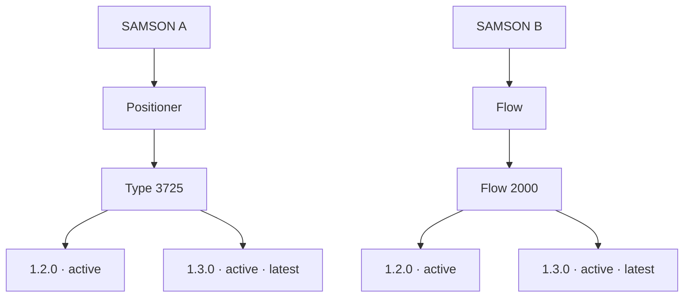

# Least-Privilege Access-Control Model

Use project grants to control **where** an identity can work and permissions to control **what** it can do. Grant access at the narrowest useful hierarchy level, keep audit identities separate from operational identities, and reserve administration for central platform teams.

The model is generic. SAMSON A and SAMSON B illustrate its derivation into two independent organisation portfolios.

## Contents

- [1. Core concepts and baseline](#1-core-concepts-and-baseline)
- [2. Generic role templates](#2-generic-role-templates)
- [3. Optional capabilities and limits](#3-optional-capabilities-and-limits)
- [4. SAMSON example](#4-samson-example)
- [5. Provisioning and CI](#5-provisioning-and-ci)
- [6. Reporting and maintenance](#6-reporting-and-maintenance)
- [7. Acceptance checks](#7-acceptance-checks)
- [8. Policy statement](#8-policy-statement)
- [9. References](#9-references)

## 1. Core concepts and baseline

This design follows the previously reviewed **5.3.0-SNAPSHOT** implementation at commit `fd55deccf61ca81457dbe773f1879bcc859fc738`. Confirm compatibility with the deployed build before rollout. The evolving `/next/` documentation was unavailable during that review.

Enable **Portfolio Access Control (PAC)** with the application configuration property:

```properties
access-management.acl.enabled=true
```

This is a property name, not an environment-variable mapping.

| Concept                      | Controls                                     | Key rule                                                    |
| ---------------------------- | -------------------------------------------- | ----------------------------------------------------------- |
| Permissions                  | Which operations an identity may perform     | Combine across direct user assignments and team memberships |
| Project-access grants (ACLs) | Which projects an identity can access        | A team grant covers the named project and every descendant  |
| Inheritance                  | How grants extend through the hierarchy      | Downward only; a child cannot deny an ancestor grant        |
| Aggregation                  | Which child data contributes to a collection | Independent of permission assignment and project access     |

A normal project-scoped operation requires **both** the required permission and access to its target. ACL entries grant access to teams; they do not assign project-specific READ, MAINTAIN, or ADMIN roles. Global administration operations do not become subtree-local through a project grant.

> [!NOTE]
> **Combined vs. split teams.** The current [access-control reference](https://dependencytrack.github.io/docs/next/concepts/access-control/) recommends *splitting* teams into **permission teams** (capabilities, no ACL) and **access teams** (ACL only, no permissions). This deployment applies the two conventions by actor type:
>
> - **Human teams** use the simpler **combined** convention: a single team carries both its permissions and its ACL (e.g. `samson-group-mantis-team` holds `VULNERABILITY_ANALYSIS_UPDATE` *and* an ACL on `Mantis`).
> - **Service accounts** use the **split**: each `*-ci` team is a pure access team (ACL only) and the service account holds its capabilities directly (`BOM_UPLOAD`, `PROJECT_CREATION_UPLOAD`). This was applied by `tools/migrate-ci-permissions.py`.
>
> Both are valid; the combined form is easier to reason about for people, while the split form gives service accounts a single, explicit unit of capability to revoke. Keep each convention consistent within its scope. See [user-management.md](user-management.md) §5 for the trade-off.

### Effective access across memberships

An identity's operation permissions apply across its entire accessible portfolio. For example, membership in an organisation auditor team plus an analyst team in another organisation permits analysis in both accessible organisations. A wider reader membership can therefore widen the reach of an existing analysis permission.

Use separate identities when one scope must remain read-only and another permits writes. Audit identities must have no mutation permissions through other teams or direct assignments.

Inheritance has four practical consequences:

- A root grant includes every group, product, and version beneath it.
- A product grant does not provide access to its parents or siblings.
- An empty version ACL retains all ancestor grants; it does not deny access.
- Revocation must remove every applicable direct or inherited access path.

## 2. Generic role templates

The roles below are reusable **team configurations**, not native per-project role objects. Derive a team by selecting its responsibility, permission profile, and project UUID. Team names are descriptive; the explicit grant establishes access.

### 2.1. Permission profiles

Define these profiles once and use them in the role tables. They are documentation shorthand, not additional permissions or built-in roles.

| Profile                        | Exact permissions                                               | Capability                                                               |
| ------------------------------ | --------------------------------------------------------------- | ------------------------------------------------------------------------ |
| **Reader (R)**                 | `VIEW_PORTFOLIO`, `VIEW_VULNERABILITY`, `VIEW_POLICY_VIOLATION` | Inspect projects, findings, and policy violations                        |
| **Vulnerability analysis (V)** | `VULNERABILITY_ANALYSIS_UPDATE`                                 | Make vulnerability-analysis decisions and upload supported VEX documents |
| **Policy analysis (P)**        | `POLICY_VIOLATION_ANALYSIS`                                     | Make policy-violation analysis decisions                                 |
| **Ingestion (I)**              | `BOM_UPLOAD`                                                    | Upload CycloneDX to accessible existing ordinary projects                |

`R + V`, for example, means the three Reader permissions plus `VULNERABILITY_ANALYSIS_UPDATE`.

### 2.2. Naming and derivation

| Placeholder       | Meaning                                    | Example                             |
| ----------------- | ------------------------------------------ | ----------------------------------- |
| `<org>`           | Stable organisation identifier             | `samson-a`, `samson-b`              |
| `<group>`         | Department/group identifier                | `positioner`, `flow`                |
| `<family>`        | Optional family/subgroup identifier        | An additional level beneath a group |
| `<product>`       | Product/service identifier                 | `type-3725`, `flow-2000`            |
| `<group-scope>`   | Organisation-qualified group               | `samson-b-flow`                     |
| `<family-scope>`  | Organisation/group-qualified family        | `<org>-<group>-<family>`            |
| `<product-scope>` | Unambiguous organisation-qualified product | `samson-b-flow-2000`                |

Use lowercase, hyphenated names. Add intermediate group/family identifiers where needed to avoid collisions. Create optional teams only for distinct responsibilities or membership; ancestor-authorised users need no duplicate child grants.

### 2.3. Central platform teams

These authorities are separate from ordinary organisation roles. The instance-wide profiles intentionally use bypass where portfolio-wide work is required.

| Team                            | Exact permissions                                                                                                 | Scope and purpose                                                                                           |
| ------------------------------- | ----------------------------------------------------------------------------------------------------------------- | ----------------------------------------------------------------------------------------------------------- |
| `platform-access-admins`        | `ACCESS_MANAGEMENT`, `VIEW_PORTFOLIO`, `PORTFOLIO_ACCESS_CONTROL_BYPASS`                                          | Instance-wide user, team, credential, and ACL administration with portfolio visibility                      |
| `platform-project-provisioners` | `VIEW_PORTFOLIO`, `PORTFOLIO_MANAGEMENT_CREATE`, `PORTFOLIO_MANAGEMENT_UPDATE`, `PORTFOLIO_ACCESS_CONTROL_BYPASS` | Create collections/releases and maintain parents, metadata, lifecycle, and latest flags across the instance |
| `platform-config-admins`        | `SYSTEM_CONFIGURATION`                                                                                            | Global configuration, including PAC settings                                                                |

Assign only the central duties required. Project deletion is deliberately absent from the provisioner baseline. Bypass removes PAC restrictions but does not supply missing operation permissions. Keep administrative identities separate from routine product work.

### 2.4. Organisation root roles

Grant these teams access to the organisation root; that grant includes all descendants.

| Team template    | Profile   | Purpose                                             |
| ---------------- | --------- | --------------------------------------------------- |
| `<org>-security` | R + V + P | Organisation-wide vulnerability and policy analysis |
| `<org>-auditors` | R         | Read-only security oversight                        |

Neither profile manages users, ACLs, hierarchy, or system configuration.

### 2.5. Department and group roles

Grant access to the group collection and its descendants.

| Team template                       | Profile   | Purpose                                    |
| ----------------------------------- | --------- | ------------------------------------------ |
| `<group-scope>-leads`               | R         | Default read-only group oversight          |
| `<group-scope>-analysts` — optional | R + V + P | Operational analysis throughout the group  |
| `<group-scope>-readers` — optional  | R         | Separate stakeholder membership, if needed |

Leads and readers have identical permissions. Separate them only for different membership or ownership needs. A job title such as group administrator does not justify project-management permissions.

### 2.6. Product-family and subgroup roles — optional

Grant access to the family/subgroup collection and its descendants.

| Team template             | Profile   | Purpose                            |
| ------------------------- | --------- | ---------------------------------- |
| `<family-scope>-analysts` | R + V + P | Analyse findings across the family |
| `<family-scope>-readers`  | R         | Read-only family visibility        |

Insert this level between group and product only when needed, using `AGGREGATE_DIRECT_CHILDREN`. The SAMSON example has no separate family level.

### 2.7. Product and service roles

Grant access to the product collection and its descendant versions.

| Team template                        | Profile | Purpose                                           |
| ------------------------------------ | ------- | ------------------------------------------------- |
| `<product-scope>-team`               | R + V   | Product finding review and vulnerability analysis |
| `<product-scope>-readers` — optional | R       | Read-only developer, QA, or reviewer access       |
| `<product-scope>-ci`                 | I       | Dedicated machine credential for SBOM ingestion   |

The product team is the default maintainer profile; it does not administer project lifecycle or hierarchy. Add P only when product staff must decide policy violations. Optional readers require their own product grant.

CI uploads target existing ordinary version projects. A collection cannot receive an SBOM. Product-level CI access covers all descendant versions, including older releases; it is neither append-only nor latest-only.

### 2.8. Membership rules

1. Choose the narrowest grant and smallest operation set that meet the responsibility.
2. Keep human review/analysis teams separate from machine-ingestion teams.
3. Review each identity's complete permission set and access paths, including direct assignments.
4. Use separate identities for audit and operational duties when read-only boundaries must remain enforceable.

Ordinary baseline teams receive no `ACCESS_MANAGEMENT` variants, `PORTFOLIO_ACCESS_CONTROL_BYPASS`, `PORTFOLIO_MANAGEMENT` create/update/delete capabilities, `PROJECT_CREATION_UPLOAD`, system configuration, or shared-policy administration permissions.

## 3. Optional capabilities and limits

These are exceptions to the baseline, not powers implied by a team name. In particular, `admins` and `maintainers` are not enforceable subtree-administrator roles.

| Requested capability                                         | Additional permission(s)                          | Native limit                                                                                | Recommended handling                                  |
| ------------------------------------------------------------ | ------------------------------------------------- | ------------------------------------------------------------------------------------------- | ----------------------------------------------------- |
| Project maintenance                                          | `PORTFOLIO_MANAGEMENT_UPDATE`                     | Includes reparenting and other mutations; not metadata-only, and some operations are global | Keep central unless the broader authority is accepted |
| Project creation through the API                             | `PORTFOLIO_MANAGEMENT_CREATE`                     | A parent is optional; no mandatory subtree boundary                                         | Use a trusted provisioner                             |
| Auto-creation on SBOM upload                                 | `PROJECT_CREATION_UPLOAD` with `BOM_UPLOAD`       | Checks a supplied parent but does not require one                                           | Keep disabled for strict product CI                   |
| Access administration                                        | `ACCESS_MANAGEMENT` or relevant granular variants | ACL mutations are not organisation-scoped                                                   | Reserve for central access administrators             |
| Read one organisation and analyse another using one identity | No safe role combination                          | Analysis permissions apply across both accessible scopes                                    | Use separate identities                               |

`PROJECT_CREATION_UPLOAD` is an upload-time creation permission, not general organisation administration. A CI team holding it with `BOM_UPLOAD` cannot be described as able to create releases **only** beneath its assigned product. Enforcing that restriction requires additional controls.

The example and acceptance checks below retain the strict baseline: CI uploads existing releases; central provisioners create them. For release-specific write isolation, use a separate credential/team with a direct grant on that version.

## 4. SAMSON example

The generic model derives into two separate roots:

- **SAMSON A → Positioner → Type 3725**
- **SAMSON B → Flow → Flow 2000**

There is no shared SAMSON parent with inherited grants. Flow 2000 release versions are illustrative and mirror Type 3725.

### 4.1. Hierarchy diagram



### 4.2. Collections and explicit grants

| Collection   | Parent     | `collectionLogic`                   | Explicit access teams                              |
| ------------ | ---------- | ----------------------------------- | -------------------------------------------------- |
| `SAMSON A`   | None       | `AGGREGATE_DIRECT_CHILDREN`         | `samson-a-security`, `samson-a-auditors`           |
| `Positioner` | SAMSON A   | `AGGREGATE_DIRECT_CHILDREN`         | `samson-a-positioner-leads`                        |
| `Type 3725`  | Positioner | `AGGREGATE_LATEST_VERSION_CHILDREN` | `samson-a-type-3725-team`, `samson-a-type-3725-ci` |
| `SAMSON B`   | None       | `AGGREGATE_DIRECT_CHILDREN`         | `samson-b-security`, `samson-b-auditors`           |
| `Flow`       | SAMSON B   | `AGGREGATE_DIRECT_CHILDREN`         | `samson-b-flow-leads`                              |
| `Flow 2000`  | Flow       | `AGGREGATE_LATEST_VERSION_CHILDREN` | `samson-b-flow-2000-team`, `samson-b-flow-2000-ci` |

All six are collection projects with `version=null`, `isLatest=false`, and no classifier. Establish parent relationships using UUIDs. Names and slashes alone do not establish hierarchy or access.

Name/version uniqueness is instance-wide. Qualify recurring collection names, for example `SAMSON Flow 2000`. The short collection names above are valid for this example; ordinary release projects use qualified names.

### 4.3. Versioned SBOM projects

Create ordinary projects beneath each product collection, with `collectionLogic=null`.

| Field                 | SAMSON A                                                 | SAMSON B                                 |
| --------------------- | -------------------------------------------------------- | ---------------------------------------- |
| Project name          | `Type 3725`                                              | `Flow 2000`                              |
| Parent                | Type 3725 collection UUID                                | Flow 2000 collection UUID                |
| Versions              | `1.2.0`, `1.3.0`                                         | `1.2.0`, `1.3.0`                         |
| Classifier            | `APPLICATION`, if appropriate to the SBOM component type | Same                                     |
| Active                | Both while supported                                     | Both while supported                     |
| Latest                | `1.2.0=false`; `1.3.0=true`                              | Same                                     |
| SBOM                  | CycloneDX                                                | CycloneDX                                |
| Tag                   | `team-samson-a-type-3725`                                | `team-samson-b-flow-2000`                |
| Ownership metadata    | `ownership.team=samson-a-type-3725-team`                 | `ownership.team=samson-b-flow-2000-team` |
| Explicit access teams | Empty; inherited from ancestors                          | Empty; inherited from ancestors          |

Ownership metadata is logical key/value notation, not an API payload. Tags and properties do not enforce access. At this commit, active state corresponds to `inactiveSince=null`.

### 4.4. Detailed plaintext trees

ACL entries list explicit access teams; their operation profiles are defined in Section 2. Each version inherits every applicable ancestor grant.

```plaintext
Organisation A
│  Name: SAMSON A
│  Type: Collection Project
│  Logic: AGGREGATE_DIRECT_CHILDREN
│  ACL (explicit access teams):
│    - samson-a-security
│    - samson-a-auditors
│
└── Group
    │  Name: Positioner
    │  Type: Collection Project
    │  Logic: AGGREGATE_DIRECT_CHILDREN
    │  ACL (explicit access teams):
    │    - samson-a-positioner-leads
    │
    └── Product
        │  Name: Type 3725
        │  Type: Collection Project
        │  Logic: AGGREGATE_LATEST_VERSION_CHILDREN
        │  ACL (explicit access teams):
        │    - samson-a-type-3725-team
        │    - samson-a-type-3725-ci
        │
        ├── Project
        │   Name: Type 3725
        │   Version: 1.2.0
        │   Classifier: APPLICATION (if appropriate to SBOM component type)
        │   Active: true (while supported)
        │   Latest: false
        │   SBOM: CycloneDX
        │   Tag: team-samson-a-type-3725
        │   Ownership: ownership.team=samson-a-type-3725-team
        │   ACL: none explicit; inherited from Type 3725,
        │        Positioner, and SAMSON A
        │
        └── Project
            Name: Type 3725
            Version: 1.3.0
            Classifier: APPLICATION (if appropriate to SBOM component type)
            Active: true (while supported)
            Latest: true
            SBOM: CycloneDX
            Tag: team-samson-a-type-3725
            Ownership: ownership.team=samson-a-type-3725-team
            ACL: none explicit; inherited from Type 3725,
                 Positioner, and SAMSON A

Organisation B
│  Name: SAMSON B
│  Type: Collection Project
│  Logic: AGGREGATE_DIRECT_CHILDREN
│  ACL (explicit access teams):
│    - samson-b-security
│    - samson-b-auditors
│
└── Group
    │  Name: Flow
    │  Type: Collection Project
    │  Logic: AGGREGATE_DIRECT_CHILDREN
    │  ACL (explicit access teams):
    │    - samson-b-flow-leads
    │
    └── Product
        │  Name: Flow 2000
        │  Type: Collection Project
        │  Logic: AGGREGATE_LATEST_VERSION_CHILDREN
        │  ACL (explicit access teams):
        │    - samson-b-flow-2000-team
        │    - samson-b-flow-2000-ci
        │
        ├── Project
        │   Name: Flow 2000
        │   Version: 1.2.0
        │   Classifier: APPLICATION (if appropriate to SBOM component type)
        │   Active: true (while supported)
        │   Latest: false
        │   SBOM: CycloneDX
        │   Tag: team-samson-b-flow-2000
        │   Ownership: ownership.team=samson-b-flow-2000-team
        │   ACL: none explicit; inherited from Flow 2000,
        │        Flow, and SAMSON B
        │
        └── Project
            Name: Flow 2000
            Version: 1.3.0
            Classifier: APPLICATION (if appropriate to SBOM component type)
            Active: true (while supported)
            Latest: true
            SBOM: CycloneDX
            Tag: team-samson-b-flow-2000
            Ownership: ownership.team=samson-b-flow-2000-team
            ACL: none explicit; inherited from Flow 2000,
                 Flow, and SAMSON B
```

### 4.5. Team derivation

| Template/profile               | SAMSON A team               | SAMSON B team             | Grant target          |
| ------------------------------ | --------------------------- | ------------------------- | --------------------- |
| `<org>-security` — R + V + P   | `samson-a-security`         | `samson-b-security`       | Respective root       |
| `<org>-auditors` — R           | `samson-a-auditors`         | `samson-b-auditors`       | Respective root       |
| `<group-scope>-leads` — R      | `samson-a-positioner-leads` | `samson-b-flow-leads`     | Positioner / Flow     |
| `<product-scope>-team` — R + V | `samson-a-type-3725-team`   | `samson-b-flow-2000-team` | Type 3725 / Flow 2000 |
| `<product-scope>-ci` — I       | `samson-a-type-3725-ci`     | `samson-b-flow-2000-ci`   | Type 3725 / Flow 2000 |

For Flow 2000, substitute `samson-b-flow-2000` for `<product-scope>` and grant the resulting teams access to its collection UUID. Version projects need no direct grants. Positioner and Flow are group collections, not separate family levels.

Optional templates become active only after their teams, memberships, and grants are configured. An optional `samson-cross-org-auditors` team uses R with explicit grants on both roots; its members must have no mutation permissions elsewhere.

### 4.6. Effective-access examples

| Membership                                | Result                                                                               |
| ----------------------------------------- | ------------------------------------------------------------------------------------ |
| `samson-a-auditors` only                  | Read SAMSON A; no SAMSON B project access                                            |
| `samson-b-security` only                  | Analyse SAMSON B; no SAMSON A project access                                         |
| `samson-b-flow-2000-ci` only              | Upload to existing Flow 2000 versions; no Type 3725 access                           |
| Both organisation auditor teams           | Read both organisations                                                              |
| `samson-a-auditors` + `samson-b-security` | Analysis authority in both accessible organisations; SAMSON A is no longer read-only |

## 5. Provisioning and CI

1. A trusted provisioner creates the release under the approved product UUID.
2. It sets the version, classifier, ownership metadata, supported state, and intended latest flag.
3. It leaves explicit version ACLs empty so ancestor grants provide access.
4. CI receives the version UUID and uploads CycloneDX with its dedicated `BOM_UPLOAD` credential.
5. Auto-creation stays disabled; CI checks processing completion.
6. Previous supported releases stay active until support ends.

`BOM_UPLOAD` alone cannot create a missing release. CI credentials must not inherit administrative or unrelated memberships. Creation exceptions and release-specific credentials are described in Section 3.

## 6. Reporting and maintenance

### 6.1. Latest versus supported releases

`AGGREGATE_LATEST_VERSION_CHILDREN` selects children explicitly marked latest; it does not compare version strings. Only one project per name may be latest across the instance.

In this example, product and ancestor rollups include `1.3.0`. Supported `1.2.0` stays accessible but is excluded. For reporting over every supported release, use `AGGREGATE_DIRECT_CHILDREN` at product level and verify lifecycle filtering. Ancestor collections respect the collection logic of their children.

### 6.2. Operational reviews

| Change                            | Required action                                                                                 |
| --------------------------------- | ----------------------------------------------------------------------------------------------- |
| Membership                        | Review the identity's full permission union and accessible scope                                |
| Ownership transfer or reparenting | Review old/new inherited access and retained explicit grants                                    |
| End of support                    | Update lifecycle state; inactivity does not revoke access                                       |
| Key rotation                      | Test replacement, switch pipeline, revoke old key, verify rejection                             |
| User/team revocation              | Remove every access path and test existing and fresh sessions                                   |
| Periodic review                   | Check grants, memberships, direct permissions, parents, bypass holders, and unparented projects |

## 7. Acceptance checks

These are proposed deployment tests, not results from an installation.

- [ ] PAC is enabled before ordinary users are onboarded.
- [ ] Each organisation's identities can access its projects but not the other root or its known project UUIDs.
- [ ] Product identities cannot access unrelated products or gain parent access through a child grant.
- [ ] Auditors cannot upload SBOMs, alter findings, modify projects, or change ACLs.
- [ ] CI uploads succeed for assigned existing versions and fail outside the product.
- [ ] CI creation and auto-creation attempts are denied under the baseline.
- [ ] New versions inherit the intended organisation, group, product, and CI access.
- [ ] Empty version ACLs retain ancestor access.
- [ ] Combined memberships do not unintentionally give auditors write authority.
- [ ] Search, exports, embedded references, metrics, and aggregates respect the intended scope.
- [ ] Reparenting and revocation produce the intended changes, including retained explicit grants and existing-session behaviour.
- [ ] Latest-version rollups exclude older releases as intended.

## 8. Policy statement

> Grant access at the narrowest appropriate hierarchy level. Organisation and group grants include all descendants, and operation permissions apply across an identity's entire accessible portfolio. Central teams administer identities, ACLs, and project structure. Separate audit identities remain read-only; dedicated product CI credentials upload to pre-provisioned accessible releases.

## 9. References

All source links are pinned to the reviewed commit.

- [Portfolio Access Control](https://github.com/DependencyTrack/dependency-track/blob/fd55deccf61ca81457dbe773f1879bcc859fc738/docs/PORTFOLIO_ACCESS_CONTROL.md)
- [Version baseline](https://github.com/DependencyTrack/dependency-track/blob/fd55deccf61ca81457dbe773f1879bcc859fc738/pom.xml)
- [Permission definitions](https://github.com/DependencyTrack/dependency-track/blob/fd55deccf61ca81457dbe773f1879bcc859fc738/apiserver/src/main/java/org/dependencytrack/auth/Permissions.java)
- [Project creation and updates](https://github.com/DependencyTrack/dependency-track/blob/fd55deccf61ca81457dbe773f1879bcc859fc738/apiserver/src/main/java/org/dependencytrack/resources/v1/ProjectResource.java)
- [ACL management](https://github.com/DependencyTrack/dependency-track/blob/fd55deccf61ca81457dbe773f1879bcc859fc738/apiserver/src/main/java/org/dependencytrack/resources/v1/AccessControlResource.java)
- [SBOM ingestion](https://github.com/DependencyTrack/dependency-track/blob/fd55deccf61ca81457dbe773f1879bcc859fc738/apiserver/src/main/java/org/dependencytrack/resources/v1/BomResource.java)
- [Collection aggregation](https://github.com/DependencyTrack/dependency-track/blob/fd55deccf61ca81457dbe773f1879bcc859fc738/apiserver/src/main/java/org/dependencytrack/model/ProjectCollectionLogic.java)


```plaintext

Organisation: SAMSON Group
│  Logic: AGGREGATE_DIRECT_CHILDREN
│  ACL: samson-group-security (R+V+P), samson-group-auditors (R)
│
├── Positioner  (AGGREGATE_DIRECT_CHILDREN)
│   │  ACL: samson-group-positioner-leads (R)
│   ├── Type 3719  (AGGREGATE_LATEST_VERSION_CHILDREN)
│   │   │  ACL: samson-group-type-3719-team (R+V), samson-group-type-3719-ci (I)
│   │   ├── 1.2.0 (active, not latest)  tag: team-samson-a-type-3719
│   │   └── 1.3.0 (active, latest)      tag: team-samson-a-type-3719
│   ├── Type 3725  (AGGREGATE_LATEST_VERSION_CHILDREN)
│   │   │  ACL: samson-group-type-3725-team (R+V), samson-group-type-3725-ci (I), samson-group-type-3725-readers (R)
│   │   ├── 1.2.0 (active, not latest)  tag: team-samson-a-type-3725
│   │   └── 1.3.0 (active, latest)      tag: team-samson-a-type-3725
│   ├── Type 5827  (AGGREGATE_LATEST_VERSION_CHILDREN)
│   │   │  ACL: samson-group-type-5827-team (R+V), samson-group-type-5827-ci (I)
│   │   ├── 1.2.0 (active, not latest)  tag: team-samson-a-type-5827
│   │   └── 1.3.0 (active, latest)      tag: team-samson-a-type-5827
│   └── Type 6111  (AGGREGATE_LATEST_VERSION_CHILDREN)
│       │  ACL: samson-group-type-6111-team (R+V), samson-group-type-6111-ci (I)
│       ├── 1.2.0 (active, not latest)  tag: team-samson-a-type-6111
│       └── 1.3.0 (active, latest)      tag: team-samson-a-type-6111
│
└── E-Devops  (AGGREGATE_DIRECT_CHILDREN)
    │  ACL: samson-group-e-devops-leads (R)
    ├── Services  (AGGREGATE_DIRECT_CHILDREN)
    │   │  ACL: samson-group-e-devops-services-leads (R)
    │   ├── Subversion  (AGGREGATE_LATEST_VERSION_CHILDREN)
    │   │   │  ACL: samson-group-subversion-team (R+V), samson-group-subversion-ci (I)
    │   ├── Sync_SP_Jama  (AGGREGATE_LATEST_VERSION_CHILDREN)
    │   │   │  ACL: samson-group-sync-sp-jama-team (R+V), samson-group-sync-sp-jama-ci (I)
    │   └── Sync-Mantis-Jama  (AGGREGATE_DIRECT_CHILDREN)
    │       │  ACL: samson-group-sync-mantis-jama-leads (R)
    │       ├── Sync-Mantis-Jama-Server  (AGGREGATE_LATEST_VERSION_CHILDREN)
    │       │   │  ACL: samson-group-sync-mantis-jama-server-team (R+V), samson-group-sync-mantis-jama-server-ci (I)
    │       └── Sync-Mantis-Jama-UI  (AGGREGATE_LATEST_VERSION_CHILDREN)
    │           │  ACL: samson-group-sync-mantis-jama-ui-team (R+V), samson-group-sync-mantis-jama-ui-ci (I)
    └── MantisBT  (AGGREGATE_DIRECT_CHILDREN)
        │  ACL: (none yet)
        └── Mantis  (AGGREGATE_LATEST_VERSION_CHILDREN)
            │  ACL: (none yet)
```
