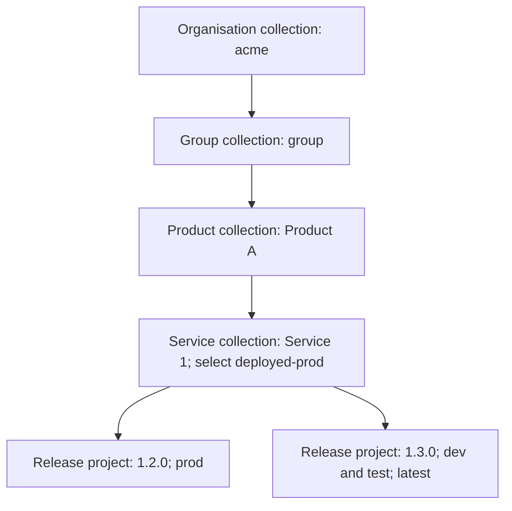

# Organisation Hierarchy Model

Dependency-Track models a **project** as the primary unit of tracking for components, findings, policy violations, metrics, and access control. For a logical model of **Product → Service / Component → Release / Environment**, the most maintainable enterprise mapping is to use project hierarchy for stable containment, regular projects for SBOM-bearing releases, tags for cross-cutting classifications, and Portfolio Access Control (PAC) for authorization boundaries.

The recommendations below distinguish documented Dependency-Track behaviour from architectural conventions inferred from that behaviour.

- [1. Benefits](#1-benefits)
- [2. Reference Model](#2-reference-model)
  - [2.1. Collection Aggregation](#21-collection-aggregation)
  - [2.2. Metadata and Authorization](#22-metadata-and-authorization)
  - [2.3. Naming and Metadata Schema](#23-naming-and-metadata-schema)
  - [2.4. Hierarchy](#24-hierarchy)
  - [2.5. Release and Environment](#25-release-and-environment)
- [3. Collections, Tags, and Properties](#3-collections-tags-and-properties)
- [4. Access Control](#4-access-control)
  - [4.1. Permission Composition](#41-permission-composition)
  - [4.2. Provisioning and Automation](#42-provisioning-and-automation)
- [5. Naming and Metadata Conventions](#5-naming-and-metadata-conventions)
- [6. Example](#6-example)
  - [6.1. Project Records](#61-project-records)
  - [6.2. Logical Model](#62-logical-model)
  - [Access Management](#access-management)
- [7. Trade-offs](#7-trade-offs)
- [8. References](#8-references)

## 1. Benefits

- Aggregated Risk Visibility
  > Placing collection projects at the product and service level produces a single risk score, vulnerability count, and policy-violation count per grouping, instead of requiring that report to be assembled by hand across many unrelated projects.

- Inherited Access Control
  > Access Control List (ACL) grants propagate down the project hierarchy. A structure that mirrors team ownership lets an administrator grant access once, at the top of a subtree, instead of on every release.

## 2. Reference Model

[Project](https://github.com/DependencyTrack/docs/blob/main/docs/reference/projects.md) hierarchy and collection logic to **aggregate and manage** risk, access control, and metadata propagate through the system.

### 2.1. Collection Aggregation

Collection modes operate on **direct children** of a collection project.

| Collection logic                     | Selected children                                  | Appropriate reporting question                                               |
| ------------------------------------ | -------------------------------------------------- | ---------------------------------------------------------------------------- |
| `AGGREGATE_DIRECT_CHILDREN`          | Every direct child                                 | What is the combined state of these service collections?                     |
| `AGGREGATE_DIRECT_CHILDREN_WITH_TAG` | Direct children with the configured collection tag | Which release inventories currently contribute to production?                |
| `AGGREGATE_LATEST_VERSION_CHILDREN`  | Direct children flagged as latest                  | What is the selected latest release of each directly contained project name? |

### 2.2. Metadata and Authorization

| Mechanism             | Purpose                                                                            | Limitation                                                                     |
| --------------------- | ---------------------------------------------------------------------------------- | ------------------------------------------------------------------------------ |
| Tags                  | Shared labels for filtering, policy scope, notifications, and collection selection | Flat names; no hierarchy, typed values, or tag-level ACL                       |
| Project properties    | Typed, grouped key-value data associated with a project                            | The documented policy, alerting, and collection mechanisms do not consume them |
| Teams and permissions | Define the operations available to principals                                      | Permissions combine globally across team memberships                           |
| Project access lists  | Define the projects on which those permissions apply when PAC is enabled           | Ancestor grants flow to descendants; child grants cannot deny inherited access |

Portfolio Access Control (PAC) must be enabled to restrict project access. Without it, principals with `VIEW_PORTFOLIO` can see all projects. With it, both the operation permission and project access are required. Tags do not grant or restrict access. These are documented behaviours, not naming conventions.

### 2.3. Naming and Metadata Schema

The following schema is an architectural convention. Identifiers should remain stable through display-name or management changes.

| Field                   | Convention                                               | Example                                                                                    |
| ----------------------- | -------------------------------------------------------- | ------------------------------------------------------------------------------------------ |
| Collection name         | Reserved `collection/` prefix plus stable catalogue path | `collection/acme/group/product-a/service-1`                                                |
| Collection version      | Unset                                                    | No release version on an organisational group                                              |
| Regular project name    | Stable, globally unique service or artifact path         | `acme/group/product-a/service-1`                                                           |
| Regular project version | Exact immutable release or build identity                | `1.2.0`, `1.3.0`, or an agreed build revision                                              |
| Classifier              | Actual artifact category                                 | `APPLICATION` for a service application, `CONTAINER` for an image, `LIBRARY` for a library |
| Collection classifier   | None                                                     | Collection mode has no classifier                                                          |
| Organisational labels   | Controlled lowercase categorical names                   | `product-a`, `service-1`, `owner-team-product-a`                                           |
| Deployment labels       | Controlled environment vocabulary                        | `deployed-dev`, `deployed-test`, `deployed-prod`                                           |
| Policy labels           | Explicit policy category                                 | `internet-facing`, `pci`, `production-candidate`                                           |
| Ownership properties    | Group `organisation`; typed `STRING` values              | `product-id=product-a`, `service-id=service-1`, `owner-team=team-product-a`                |
| Artifact properties     | Group `artifact`; typed `STRING` values                  | `digest`, `source-revision`                                                                |
| Reference properties    | Appropriate `URL` values or native external references   | Source repository, build evidence, deployment record                                       |

> [!NOTE]
> Management of [project retention](https://github.com/DependencyTrack/docs/blob/main/docs/guides/administration/configuring-project-retention.md) for inactive projects is important to ensure that outdated or unused projects do not clutter the system and that storage resources are efficiently utilized.

### 2.4. Hierarchy

```plaintext
Product                         Collection Project
└── Service / Component         Collection Project
    ├── Release 1.2.0           Regular Project + SBOM
    └── Release 1.3.0           Regular Project + SBOM
```

- Collection Project
  > **Documented.** A collection project is a parent used for metric aggregation. It has no classifier, contains no components or services, has no dependency graph, and does not accept BOM uploads.

- Project Identity
  > **Documented.** Project `name + version` is globally unique across the instance. Hierarchy does not create a namespace.

- Product
  > **Recommended.** Represent a product as a collection project when it is a logical grouping rather than an independently SBOM-bearing artifact.

- Service / Component
  > **Recommended.** Represent an independently released service, application, library, firmware unit, or similar software item as a collection project when multiple releases must be tracked beneath it.

- Release
  > **Recommended.** Represent each release requiring historical traceability as a regular SBOM-bearing project. Projects sharing the same name and using different `version` values form the native version lineage.

### 2.5. Release and Environment

Environment should normally remain metadata when the same immutable release artifact is deployed to multiple environments.

- Release-oriented default
  > **Recommended.** Store the SBOM on the release project and represent deployment environments using tags such as `env-dev`, `env-test`, and `env-prod`.

- Environment-specific project
  > **Recommended exception.** Create separate environment projects when the deployed BOM, vulnerability audit state, policy state, lifecycle, or ACL must differ independently by environment.

- Repeated upload to the same project version
  > **Documented.** Dependency-Track reconciles the existing project inventory. This is appropriate for rolling or unreleased states such as `main` or `dev`, but it does not preserve immutable release inventories as separate projects.

- Latest version
  > **Documented.** Version strings are opaque and are not semantically sorted. The `latest version` marker is maintained explicitly and can drive collection aggregation.

## 3. Collections, Tags, and Properties

Hierarchy and tags overlap as organisational mechanisms but have different semantics.

| Concern                          | Preferred mechanism | Rationale                                 |
| -------------------------------- | ------------------- | ----------------------------------------- |
| Product contains services        | Project hierarchy   | Stable one-parent structural relationship |
| Service contains releases        | Project hierarchy   | Native version and lifecycle model        |
| ACL inheritance                  | Project hierarchy   | Parent access propagates to descendants   |
| Product/service risk aggregation | Collection project  | Native metric aggregation                 |
| Environment                      | Tag by default      | Cross-cutting classification              |
| Compliance scope                 | Tag                 | Supports policy and alert scoping         |
| Exposure or criticality          | Tag                 | Many-to-many classification               |
| CMDB ID, repository, owner ID    | Project property    | Typed key-value metadata                  |

- Tags
  > **Documented.** Tags are global name-only labels with many-to-many attachment. They support project filtering, policy assignment, alert scoping, and tag-filtered collection aggregation. Tags have no per-tag access control.

- Project Properties
  > **Documented.** Properties are typed key-value metadata scoped to one project. Built-in policy, alert, and collection logic does not use them for scoping.

- Collection scope
  > **Documented.** Collection rules select direct children. A product collection cannot filter release grandchildren by their environment tags; configure the intended release selection on each service collection, then aggregate those service collections at the product level.

- Tags as hierarchy
  > **Not recommended.** A tag-only hierarchy provides no parent-child navigation, ACL inheritance, structural aggregation, or enforced containment. Tags should describe orthogonal dimensions rather than replace the canonical project tree.

## 4. Access Control

Dependency-Track separates global capabilities from project visibility.

```plaintext
Effective operation = Permission AND ACL access
```

- Permissions
  > **Documented.** Permissions define allowed operations such as `VIEW_PORTFOLIO`, `BOM_UPLOAD`, `PORTFOLIO_MANAGEMENT_UPDATE`, or `VULNERABILITY_ANALYSIS`.

- Portfolio Access Control
  > **Documented.** With PAC enabled, project ACL access is additionally required for project operations, unless the principal holds `PORTFOLIO_ACCESS_CONTROL_BYPASS`.

- Hierarchical inheritance
  > **Documented.** A team granted access to a parent project can access its descendants. Descendants cannot revoke access inherited from an ancestor.

- Product boundary
  > **Recommended.** Assign a product access team at the product collection when the same group may access all services beneath it.

- Service boundary
  > **Recommended.** Assign service-specific access teams at service collections when service teams must not see one another. Release projects then inherit access automatically.

- Role/access separation
  > **Recommended and documented as a pattern.** Maintain permission teams for capabilities and access teams for project scope. A principal belongs to one or more of each.

Example:

```plaintext
role-sbom-developer
  permissions: VIEW_PORTFOLIO, BOM_UPLOAD, VIEW_VULNERABILITY

access-product-a-service-1
  ACL: Product A / Service 1

user membership:
  role-sbom-developer + access-product-a-service-1
```

The vendored chart defaults to Dependency-Track 5.0.4. For automation on this version, use a team API key whose owning team has both the required permissions and project ACL access; a team API key does not combine memberships from separate role and access teams. Dedicated service accounts require Dependency-Track 5.2.0 or later.

### 4.1. Permission Composition

[Permission](https://github.com/DependencyTrack/docs/blob/main/docs/reference/permissions.md) teams and access teams can be separated for maintainability: a role team provides capabilities, while an access team identifies a product or service scope. However, the resulting rights are the union of capabilities applied across the union of accessible projects.

Consequently, membership granting write capability for Product A and read access to Product B also permits writing Product B when the global write permission applies. The model does not bind a capability exclusively to the team that supplied a particular ACL grant. A requirement for one identity to write one product but only read another needs a different identity arrangement or a stronger separation design; it cannot be solved by team naming alone.

| Role                    | Permissions                                                                                                  | Scope                                   |
| ----------------------- | ------------------------------------------------------------------------------------------------------------ | --------------------------------------- |
| Security Reader         | `VIEW_PORTFOLIO`, `VIEW_VULNERABILITY`, `VIEW_POLICY_VIOLATION`                                              | Assigned product or service subtree     |
| Maintainer              | Security Reader, `PORTFOLIO_MANAGEMENT_UPDATE`, `VULNERABILITY_ANALYSIS_UPDATE`, `POLICY_VIOLATION_ANALYSIS` | Assigned subtree                        |
| CI uploader             | `BOM_UPLOAD`; optional read permissions for result checks                                                    | Pre-provisioned service release subtree |
| Provisioning controller | Required create/update capabilities and separately governed access-management operations                     | Approved catalogue scope                |

> [!NOTE]
> Apply only the capabilities actually needed by each integration. Do not grant `PORTFOLIO_ACCESS_CONTROL_BYPASS` to ordinary product teams or uploaders. Global policy management and access administration should remain controlled centrally because an ACL grant is not a product-local policy-administrator role.

### 4.2. Provisioning and Automation

Pre-provision release records with the intended parent and access configuration, then upload by their assigned UUID. This reduces dependence on auto-creation defaults and prevents a misspelled project name from creating an unrelated family.

The current documentation states that automation-created projects receive the creating principal's first team in alphabetical order; a service account with no teams produces no such grant. This default is not an ownership policy. When `PROJECT_CREATION_UPLOAD` is permitted, reconcile the parent, explicit ACL, tags, and properties before treating onboarding as complete. [Access control](https://github.com/DependencyTrack/docs/blob/main/docs/concepts/access-control.md).

Use service accounts where the deployed version supports them; otherwise use narrowly scoped team API keys. A CI team placed on a service collection can upload to its release descendants without receiving portfolio-wide access. Enabling PAC on an existing portfolio also requires a planned assignment rollout, since projects without accessible assignments become invisible to ordinary principals.

## 5. Naming and Metadata Conventions

| Field                     | Convention                                                   | Example                                                 |
| ------------------------- | ------------------------------------------------------------ | ------------------------------------------------------- |
| Product collection        | Human-readable stable name                                   | `Product A`                                             |
| Service collection        | Product-qualified human-readable name                        | `Product A / Service 1`                                 |
| SBOM project name         | Globally unambiguous stable identifier                       | `product-a.service-1`                                   |
| Project version           | Artifact/release identifier                                  | `1.3.0`                                                 |
| Environment-specific name | Add environment only when separate project state is required | `product-a.service-1@prod`                              |
| Classifier                | CycloneDX-aligned type                                       | `APPLICATION`, `LIBRARY`, `CONTAINER`                   |
| Environment tag           | Controlled global vocabulary                                 | `env-prod`                                              |
| Compliance tag            | Controlled global vocabulary                                 | `pci`                                                   |
| Criticality tag           | Controlled global vocabulary                                 | `criticality-tier-1`                                    |
| Ownership property        | Structured metadata                                          | `ownership.team=service-1-team`                         |
| Repository property       | Structured metadata                                          | `source.repository=git.example.org/product-a/service-1` |

`version` should describe the software artifact rather than its deployment environment unless the environment is intentionally part of project identity.

## 6. Example

The example represents Organisation `acme`, Group `group`, Product A, and Service 1. Releases `1.2.0` and `1.3.0` use the same immutable artifacts across environments. Production runs `1.2.0`; development and test run `1.3.0`. The latest selected release is `1.3.0`.

### 6.1. Project Records

Example: six Dependency-Track project records provide four collections and two SBOM-bearing releases. Row IDs are explanatory aliases, not proposed UUID values. Provisioning records the UUIDs assigned by Dependency-Track.

| ID  | Exact name                                  | Version | Parent | Type and logic                                                        | Classifier    | Latest |
| --- | ------------------------------------------- | ------- | ------ | --------------------------------------------------------------------- | ------------- | ------ |
| O   | `collection/acme`                           | Unset   | None   | Collection; `AGGREGATE_DIRECT_CHILDREN`                               | None          | No     |
| G   | `collection/acme/group`                     | Unset   | O      | Collection; `AGGREGATE_DIRECT_CHILDREN`                               | None          | No     |
| P   | `collection/acme/group/product-a`           | Unset   | G      | Collection; `AGGREGATE_DIRECT_CHILDREN`                               | None          | No     |
| S   | `collection/acme/group/product-a/service-1` | Unset   | P      | Collection; `AGGREGATE_DIRECT_CHILDREN_WITH_TAG`; tag `deployed-prod` | None          | No     |
| R12 | `acme/group/product-a/service-1`            | `1.2.0` | S      | Regular; release SBOM                                                 | `APPLICATION` | No     |
| R13 | `acme/group/product-a/service-1`            | `1.3.0` | S      | Regular; release SBOM                                                 | `APPLICATION` | Yes    |

All six records are active in this example. The collection name deliberately differs from the release family name, preventing the organisational record from participating in the same latest-version family.



Only R12 contributes to S's production aggregate. P combines service collection metrics; G and O combine their direct child collection metrics. R13 remains independently analysable and visible to authorised teams, but does not enter this production selection. For a latest-release reporting model, change S to `AGGREGATE_LATEST_VERSION_CHILDREN`; then R13 contributes instead. These are distinct reporting questions.

### 6.2. Logical Model

```plaintext
Organisation A
│   Name: <org-a>
│   Type: Collection Project
│   Logic: AGGREGATE_DIRECT_CHILDREN
│   ACL: org-a-security (access), org-a-auditors (read)
│
└── Group A
    │   Name: <group-a>
    │   Type: Collection Project
    │   Logic: AGGREGATE_DIRECT_CHILDREN
    │   ACL: group-a-leads
    │
    └── Product A / Service 1
        │   Name: <product-a/service-1>
        │   Type: Collection Project
        │   Logic: AGGREGATE_LATEST_VERSION_CHILDREN
        │   ACL: service-1-team (access), service-1-ci (CI API key team)
        │
        ├── Project
        │   Name: <product-a/service-1>
        │   Version: 1.2.0
        │   Classifier: APPLICATION (match SBOM metadata.component.type)
        │   Active: true (until end of support)
        │   Latest: false
        │   SBOM: CycloneDX
        │   Tags: team-service-1
        │   Properties: ownership.team=service-1-team
        │   ACL: none (inherited)
        │
        └── Project
            Name: <product-a/service-1>
            Version: 1.3.0
            Classifier: APPLICATION
            Active: true
            Latest: true
            SBOM: CycloneDX
            Tags: team-service-1
            Properties: ownership.team=service-1-team
            ACL: none (inherited)
```

When `1.3.0` reaches production, move the `env-prod` tag from `1.2.0` to `1.3.0`. When `1.2.0` is no longer deployed or supported, mark it inactive and allow the configured retention policy to govern eventual deletion.

> [!NOTE]
> `Latest` and `Active` express different concepts. A release can cease to be the latest while remaining active because it is still deployed or supported.
> In this example, the service's latest-version aggregation includes `1.3.0` and excludes the production release `1.2.0`. For a production-focused view, use `AGGREGATE_DIRECT_CHILDREN_WITH_TAG` with collection tag `env-prod` on the service collection instead. The product collection then aggregates that service's selected metrics.

### Access Management

## 7. Trade-offs

- Release-centric hierarchy
  > **Preferred architecture.** It aligns with native version semantics, preserves historical SBOMs, supports lifecycle retention, limits project cardinality, and provides natural service-level ACL inheritance. Environment-specific audit state is not isolated unless separate projects are introduced.

- Environment-centric hierarchy
  > **Operational alternative.** It gives stable current-state projects for `dev`, `test`, and `prod`, but repeated reconciliation weakens release-level historical traceability inside Dependency-Track.

- Full release × environment matrix
  > **High-fidelity alternative.** It provides independent SBOMs, findings, policies, metrics, and ACLs for every deployment context but multiplies project count and duplicates operational work.

The recommended enterprise architecture is therefore **one canonical Product → Service → Release tree**, with Product and Service represented by collection projects, Release represented by the SBOM-bearing regular project, environment represented by tags/properties by default, and environment-specific projects introduced only when independent tracked state is required. PAC boundaries should be placed at the narrowest stable ownership node, normally Product or Service.

## 8. References

- Dependency-Track [Projects](https://github.com/DependencyTrack/docs/blob/main/docs/reference/projects.md) reference.
- Dependency-Track [About time series metrics](https://github.com/DependencyTrack/docs/blob/main/docs/concepts/time-series-metrics.md) documentation.

- Dependency-Track [About Access Control](https://github.com/DependencyTrack/docs/blob/main/docs/concepts/access-control.md) documentation.
- Dependency-Track [Permissions](https://github.com/DependencyTrack/docs/blob/main/docs/reference/permissions.md) documentation.
- Dependency-Track [Component Policies](https://github.com/DependencyTrack/docs/blob/main/docs/reference/policies/component-policies.md) documentation.
- Dependency-Track [About Vulnerability Findings](https://github.com/DependencyTrack/docs/blob/main/docs/concepts/vulnerability-findings.md) documentation.
- Dependency-Track [About Vulnerability Policies](https://github.com/DependencyTrack/docs/blob/main/docs/concepts/vulnerability-policies.md) documentation.
- Dependency-Track [Configuring Project Retention](https://github.com/DependencyTrack/docs/blob/main/docs/guides/administration/configuring-project-retention.md) documentation.
