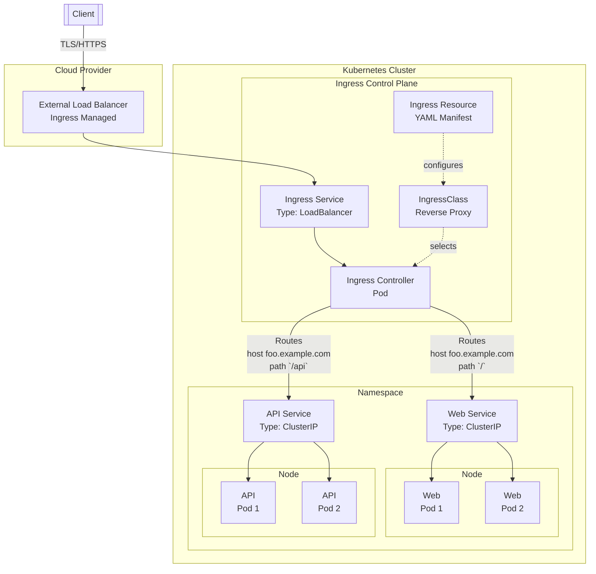
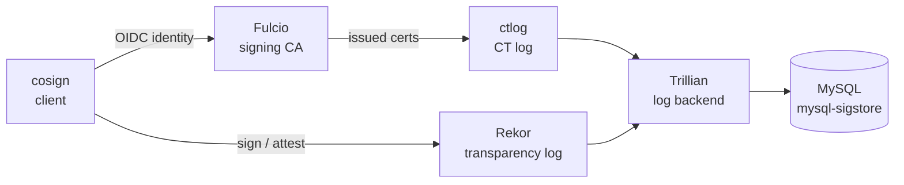

# Architecture

Architecture is a high-level overview of the system's structure, components, and interactions.

- [1. Diagrams](#1-diagrams)
- [2. Definitions](#2-definitions)
- [3. Order of Precedence](#3-order-of-precedence)
- [4. Sigstore](#4-sigstore)

## 1. Diagrams

## 2. Definitions

- Client
  > The *external* entity making an HTTP/HTTPS request to an application.

- Load Balancer
  > A *external* managed service provided by a cloud provider (AWS, GCP, Azure) outside of the Kubernetes cluster, created automatically by the Service of type `LoadBalancer`. Operates at Layer 4 (TCP/UDP) or Layer 7 (HTTP/HTTPS).

- Ingress Resource
  > A declarative Kubernetes API object that specifies routing rules (e.g., host-based, path-based) for external traffic. Centralized management as a single entry point for all HTTP/HTTPS traffic, security (TLS termination) and observability (logging, metrics).

- Ingress Service
  > A Kubernetes Service that targets the Pods of the Ingress Controller. Setting its type to `LoadBalancer`, instructs to provision an external load balancer to route traffic to the nodes on the specific `NodePort` of the service.

- IngressClass
  > A Kubernetes resource that defines the Ingress Controller to use for a specific Ingress Resource. It specifies the controller implementation (e.g., Nginx, Traefik) and its configuration.

- Ingress Controller
  > A reverse proxy server (Nginx, Traefik, or Envoy) running as a active component in a Pod within the cluster. Responsible for fulfilling the rules defined in the Ingress Resource.

- Services
  > - **LoadBalancer**: The Ingress Service of type `LoadBalancer` is created to provisions an external load balancer and expose the Ingress Controller to external traffic.
  > - **ClusterIP**: The Ingress Controller sends traffic to a regular Kubernetes Service of type `ClusterIP`. The Service is the internal default cluster communication to endpoints and load balancer, distributing traffic to the healthy Pods that match its *label selector*.

- Pods
  > The Ingress Controller routes traffic to internal ClusterIP Services, which then forward it to the application Pods.

## 3. Order of Precedence

Kustomize assembles and applies configuration in a defined hierarchy to ensure predictable overrides, lowest to highest:

- Base Resources
  > Loaded first from `resources:` in base kustomizations.

- Generators
  > ConfigMap- and Secret-generators (`configMapGenerator:`, `secretGenerator:`) produce new objects after base resources.

## 4. Sigstore

The cluster runs a self-hosted [Sigstore](https://www.sigstore.dev/) stack under `infrastructure/services/sigstore/` to provide cryptographically verifiable signing and verification of software artifacts and OCI container images.

- **Fulcio** (`fulcio-system`) issues short-lived signing certificates to identities authenticated via OIDC. It uses the `fileca` authority; the chart's `createcerts` Job generates the CA on first deploy.
- **ctlog** (`ctlog-system`) is Fulcio's Certificate Transparency log, backed by the shared Trillian log.
- **Rekor** (`rekor-system`) is the transparency log and timestamping server for signatures and attestations.
- **Trillian** (`trillian-system`) is the append-only, verifiable log backend shared by Rekor and ctlog (log server + log signer).
- **MySQL** (`mysql-sigstore`) is a dedicated database for the Trillian log and the Rekor search index. The Sigstore charts are MySQL-only, so this instance is MySQL rather than the shared PostgreSQL used by Dependency-Track.

`cosign` is pointed at the self-hosted endpoints with `--fulcio-url` and `--rekor-url` (see `make sscs-cosign-sign` / `make sscs-cosign-verify-image`).

- Base Patches
  > Any `patches:` declared within base kustomizations are applied.

- Component Patches & Transformers
  > Imported via `components:`, these patches and transformers run next.

- Overlay Patches & Transformers
  > Specified in overlays (`patches:`, `transformers:`), they override earlier modifications.

- Overlay Direct Fields
  > Top-level settings in the overlay such as `namespace:`, `namePrefix:`, `commonLabels:`, `images:` are applied last, possessing the highest precedence.
